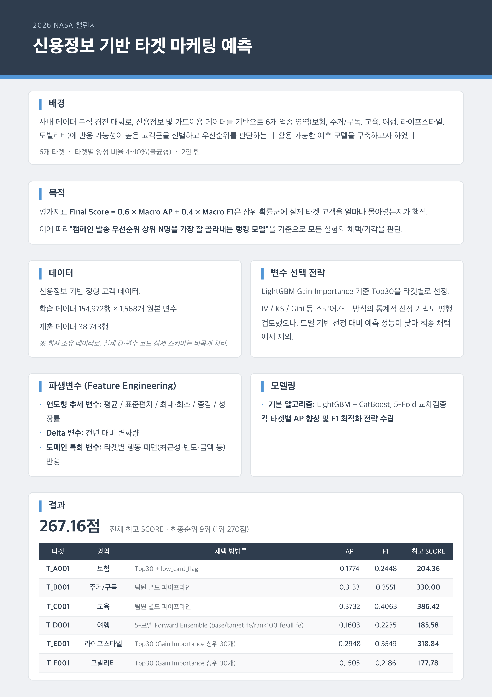

# 신용정보 및 카드이용 데이터 기반 마케팅 타겟 예측
### 반응 가능성이 높은 고객군을 선별하고 우선순위를 판단하는 데 활용 가능한 예측 모델을 구축

### 회고

- 시간변화·비율·집단비교·연체/채무불이행 등 범주를 나누어 체계적으로 파생변수를 설계했어야 함.
  (1위 팀은 카테고리별로 637개의 파생변수를 만들었다.)
- 연 단위(전년 대비) 비교에 머물지 않고 1·3·6·12개월 등 다중 시간축을 쓰되, 타겟 도메인의 특성(여행-계절, 교육-학기, 모빌리티-주말/평일, 라이프-명절)을 살려 시간 구간과 계절성 변수를 설계했어야 함.
  (2위 팀이 이 방식을 사용했다.)

## Development Log

 NASA Development Log 

- [NASA-Dev Log](https://app.notion.com/p/NASA-471589dece9f82c5897d811721874b97?source=copy_link)

## 프로젝트 문서

 분석 보고서

- [NASA_챌린지_결과보고서](./NASA%챌린지%결과보고서.docx)

